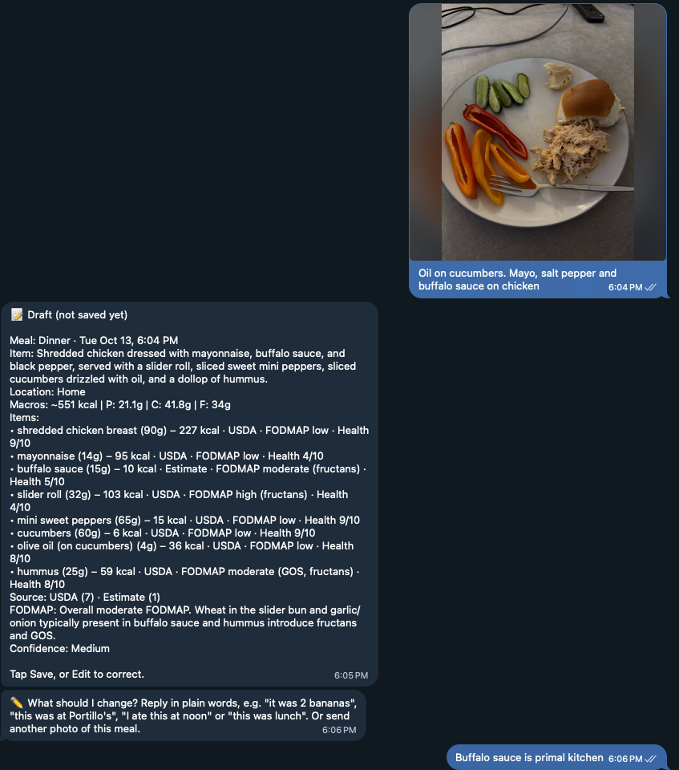

# Nutrition Bot Lite

A Telegram bot that logs what you eat. Send it a photo of your plate, a quick description, or a barcode, and within about 30 seconds it replies with calories, protein, carbs, fat and a 1–10 health score for each food. You look over the draft, tap **Save**, and every item lands as its own row in a Google Sheet that only you can see.

I built this because I wanted to create the most frictionless meal tracker possible using AI. This is a free, simplified version of the bot I use myself.

## What it does

- **Photos, text or barcodes.** Send a picture of your plate, type "chicken burrito bowl," or scan a package with the built-in barcode scanner.
- **Review before saving.** Every entry starts as a draft with **Save / Edit / Discard** buttons. Correct it in plain words, like "it was 2 bananas," "this was at Chipotle" or "I ate this at noon." Untouched drafts save themselves after 2 hours.
- **Better numbers than a guess.** For each food, it checks the restaurant's or brand's official nutrition information first, then the USDA database, then Open Food Facts for packaged food, and only then falls back to an AI estimate. The draft shows where each number came from.
- **Meals stay together.** The meal label comes from when you ate (breakfast 5–10:30 am, lunch 11 am–2 pm, dinner 5–8:30 pm, otherwise snack; all adjustable). Food eaten within an hour of a meal joins it, so dessert after dinner still counts as dinner. Saying "this is lunch" always wins.
- **Running totals.** Each draft shows how the meal adds up so far, like "Lunch today so far: 3 items, ~640 kcal."
- **One row per food.** Each item gets its own calories, macros, health score and source, which makes the Sheet easy to filter, chart or pivot.
- **Private to you.** The bot answers only your Telegram account, and your data stays in your own Google Sheet.

## Example



A real entry from the full version: a photo with a short caption, the itemized draft, and a correction in plain words before saving. Lite's drafts look the same, minus the FODMAP ratings.

## How it works

```
Telegram  →  Cloudflare Worker  →  Google Apps Script  →  Gemini AI + USDA + Open Food Facts
                                          ↓
                                    Google Sheet
```

- **Cloudflare Worker** ([`worker/worker.js`](worker/worker.js)) receives messages from Telegram, replies instantly so Telegram doesn't resend them, and passes them on. It also hosts the barcode scanner page.
- **Google Apps Script** ([`apps-script/Code.gs`](apps-script/Code.gs)) does the real work: it asks Gemini to analyze the food, checks the nutrition databases, manages drafts and saves to your Sheet.

## Get started

**No coding required.** Follow the step-by-step [Setup Guide](SETUP.md). It takes about an hour, and a one-click `setup` check at the end tells you whether everything is connected. Every service it uses has a free option; a paid Gemini plan is optional and adds the restaurant and brand lookups.

A note on privacy: your photos and descriptions are sent to Google's Gemini API for analysis. On Gemini's free tier, Google may use that data to improve its products.

## The full version

Lite covers the core of what I use, but the full version I'm still building goes further:

- **FODMAP tracking.** Every food gets a FODMAP level and the specific FODMAP groups it contains, for people managing IBS or similar conditions.
- **A real database.** Meals are stored in Postgres instead of a Sheet, so the history can be analyzed in SQL, R or a dashboard.
- **Symptom tracking** *(in progress)*. Symptoms are logged alongside meals, so you can look at what you ate in the hours before each one and find the foods that cause trouble.
- **Trend reports** *(planned)*. Daily and weekly summaries in chat.

If you're interested in the full version, or something in Lite isn't working, [open an issue](https://github.com/boilermike1/nutrition-bot-lite/issues) on this repo.

## Support

Lite is provided as-is. I'll try to fix serious bugs when they come up, but I'm not planning to add features to it; new work goes into the full version. You're welcome to fork it and take it in your own direction.

## License

[MIT](LICENSE). Free to use, change and share.

© 2026 Mike Mendel
